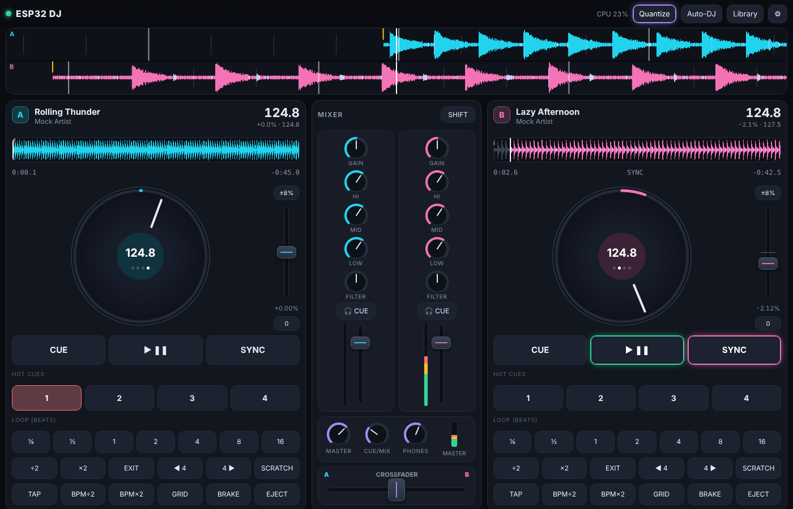

# ESP32 DJ

A two-deck MP3 DJ mixer that runs on a **Heltec WiFi LoRa 32 V3 or V4** (ESP32-S3). Music plays from a microSD card and comes out of an I2S DAC. You control it from any phone or computer browser, and nothing has to be installed.



**Flash it:** open `docs/index.html` from GitHub Pages in Chrome or Edge, then click *Install on V3* or *Install on V4*.

## Features

- **Two decks.** Each deck decodes its own MP3 in real time. Tracks can be 44.1 kHz, 48 kHz or MPEG-2 rates, mono or stereo, CBR or VBR.
- **Vinyl-style pitch** with ±8 / 16 / 50 % range, jog-wheel nudge, a **scratch** mode, brake, and sample-accurate seeking.
- **Automatic BPM and beat grid.** The ESP32 analyses the first 30–40 s of each track and caches the result on the card in `/dj/bpm.tsv`. You can also tap the tempo, halve or double it, or set the grid yourself.
- **SYNC:** matches tempo, snaps the beat phase when you press play, then keeps a gentle phase lock.
- **Cues and loops:** CUE (CDJ-style), 4 hot cues, beat loops from ¼ to 16 beats (halve, double, exit), and beat jump. **Quantize** snaps them to the grid.
- **Mixer:** 3-band isolator EQ with full kill, gain, a one-knob low-pass/high-pass filter, channel faders with VU meters, and a crossfader (smooth, sharp or linear curve). The master output has a limiter.
- **Headphone cueing:** use a second PCM5102A (the S3 has two I2S ports), or split one DAC so the left ear hears the cue and the right ear hears the master.
- **FX unit:** echo (beat-synced, with a tail that rings out), flanger, bit-crusher and beat gate. It can be applied to deck A, deck B or the master.
- **8 sound pads**, all synthesized on the chip: air horn, siren, laser, boom, riser, clap, 808 kick and rewind.
- **Auto-DJ:** plays your *Up next* queue and then random tracks, with beat-matched crossfades and a bass swap.
- **Browser UI:** scrolling beat-view waveforms, track overviews, jog wheels, a library with search, upload and delete, settings, and **firmware updates over Wi-Fi**.
- **OLED status:** both decks, BPM, time left, crossfader and IP address. A short press on PRG changes the screen; holding it toggles Auto-DJ.

## Hardware

| Part | Notes |
|---|---|
| Heltec WiFi LoRa 32 V3 or V4 | The V4 is better because its 2 MB PSRAM allows 3 s ring buffers and stereo echo |
| microSD module (3.3 V SPI) | Card formatted FAT32 |
| PCM5102A I2S DAC board | Main output; line level into speakers or an amp |
| 2nd PCM5102A (optional) | Headphone cue output |
| KCX_BT_EMITTER / 3.5 mm Bluetooth transmitter (optional) | Plugs into the DAC output to drive a Bluetooth speaker. The ESP32-S3 has no Classic Bluetooth, so it can't send A2DP audio by itself |

### Default wiring (change any pin in Settings)

| Signal | GPIO |
|---|---|
| SD CS / SCK / MOSI / MISO | 42 / 41 / 40 / 39 |
| DAC BCK / LRCK / DIN | 4 / 5 / 6 |
| Headphone DAC BCK / LRCK / DIN | 47 / 48 / 33 |
| OLED (built in) | SDA 17, SCL 18, RST 21, Vext 36 |

On the PCM5102A, tie SCK, FMT, FLT and DEMP to GND and XSMT to 3V3. Most purple breakout boards already do this through their solder jumpers.

## Using it

1. Power the board. It starts a hotspot named `ESP32-DJ-XXXX` with password `djmix1234`.
2. Join the hotspot and browse to `http://192.168.4.1`. To use your home network instead, enter its details in **Settings**; the DJ is then at `http://esp32dj.local`.
3. Open **Library**. Upload MP3s under *Files & upload*, or copy them onto the card. Then load a track on deck A and one on deck B.

PC keyboard shortcuts: `Q` cue A, `W` play A, `E` sync A, `O` cue B, `P` play B, `[` sync B, `1–4` hot cues on A, `7–0` hot cues on B.
SHIFT, at the top of the mixer, lets you tap the overview to jump while a deck is playing, or delete a hot cue.

## Building from source

Requirements: Arduino ESP32 core **3.0.x** and the **ThingPulse "ESP8266 and ESP32 OLED driver for SSD1306"** library. The Helix MP3 decoder is bundled in `src/helix`.

```bash
export PATH=/path/to/arduino-cli:$PATH
./tools/build.sh          # builds V3 + V4 into docs/firmware/ and dist/*-ota.bin
```

In the Arduino IDE, choose **ESP32S3 Dev Module**, set CPU 240 MHz and the "Minimal SPIFFS (1.9MB APP with OTA)" partition scheme, and use these per-board settings:
- **V3:** Flash 8 MB, PSRAM disabled
- **V4:** Flash 16 MB, PSRAM "QSPI", USB CDC on boot enabled

Run `python3 tools/embed_webui.py` after you edit `web/index.html`.

To test the web UI without hardware, run `python3 tools/mock_server.py --music ~/Music` and open http://localhost:8080.

## How it works

- Each deck has a decoder task on core 0. It reads the SD card, decodes MP3 with Helix, and fills a ring buffer. The buffer is indexed by a continuous timeline, so seeks, hot cues and loop wraps are added to the end of the buffer and the playhead jumps without stopping.
- The audio task runs on core 1 at the highest priority. Every 2.9 ms it does Hermite-interpolated varispeed, EQ and filters, FX, the crossfader, pads and the limiter, then sends the result to I2S.
- The analyzer task reads the whole file once to build an exact seek index of MP3 frame offsets, so seeks land on the exact sample. In the same pass it measures BPM and the beat phase using an onset envelope, autocorrelation and comb refinement.
- The browser talks to the board over a WebSocket. It sends short text commands and gets a status update 10 times a second. Waveforms are decoded in the browser, so the ESP32 doesn't have to.

## Licenses

The Helix MP3 decoder is © RealNetworks (RPSL/RCSL); see `src/helix/`. Everything else is free for personal use.
